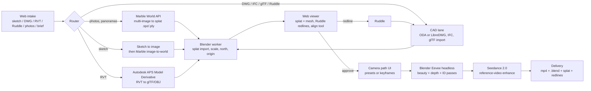

# Riddle (working title): sketch-to-ArchViz video service

Status: concept / plan. Nothing here is built yet.
Sibling of **Ruddle** (models and drawings). Riddle produces *moving pictures of a
design in its real context*, with the 3D model as the thing that makes it trustworthy.

---

## 0. Is "Riddle" a good name?

Short answer: no, not as a standalone brand. Three problems:

1. **One letter from Ruddle.** Spoken aloud, "Ruddle" and "Riddle" are near homophones in
   many accents. Support, invoices and word of mouth will mix them up constantly.
2. **Taken in software.** riddle.com (Riddle Technologies AG, Germany, since 2014) is an
   established quiz/interactive-content SaaS and claims the Riddle mark. A separate US
   "RIDDLE" application (Riddle LLC, 2025, AI game-show software) also exists. Expect
   domain and search-ranking friction at minimum, and a possible trademark objection.
3. **Wrong connotation.** A riddle is something confusing you have to solve. The product
   sells clarity: "see the scheme on the site before it is built".

### Suggested names

Ruddle is red ochre, the pigment used to mark sheep and for red chalk, which is why it fits a
redline tool. Staying inside that family keeps the two products feeling related.

| Name | Why | Notes |
|---|---|---|
| **Ruddle Reel** or **Ruddle Motion** | Sub-brand. Zero new brand-building. Customers who know Ruddle understand immediately. | Strongest option if Ruddle is the brand you intend to grow. |
| **Rendle** | Render + Ruddle. Sounds like a sibling, is pronounceable, unlikely to be confused in speech. | Check .com / .ai availability and trademark registers. |
| **Reddle** | Direct synonym of ruddle (Hardy's "reddleman"). Very on-theme. | Same near-homophone risk as Riddle. Only if the family pun matters more than clarity. |
| **Sightline** | ArchViz and planning term: what you see from where. Describes the camera-path product exactly. | Common word, likely crowded. |
| **Vantage** | Viewpoint. Short, premium feel. | Crowded. |
| **Lantern** | Reveals the site at night; also an architectural element. | Available-ish in this niche, less literal. |

Recommendation: **Ruddle Reel** (or Rendle if it must stand alone). Before committing to any
name: search USPTO TSDR and EUIPO, check the .com/.ai/.co, and check the Blender Extensions
platform and app stores for collisions.

---

## 1. The one-paragraph pitch

Drop in what you already have (a pencil sketch, a DWG, a Revit model, a Ruddle model, a
handful of site photos). Riddle builds a 3D splat of the real site, places your design in it,
lets you redline the result, asks for a camera path, renders it in Blender, hands the render to
a video model for photoreal finishing, and gives you back a short film plus the model. Pay per
film.

**Why this beats "just prompt Seedance":** a text/image video model cannot hold a design to a
drawing. The 3D model gives:

- geometric fidelity (massing, heights, setbacks, sightlines a planner can trust);
- consistency across shots and across revisions (change the design, re-render the same path);
- a second deliverable (model + splat + redlines) that feeds back into Ruddle;
- repeatability: the same camera path, the same lighting, run again next week.

Niche to own early: **water features and landscape in context**. Eevee handles water surfaces,
fountains and jets well, and that is exactly what generative video models get wrong. This is
your domain expertise and nobody else is positioned there.

---

## 2. Pipeline



### 2.1 Intake (web page)

Single drop zone, no account needed to start. Accept:

| Input | v1 | How it is handled |
|---|---|---|
| Site photos (3 to 12), phone panoramas | yes | Marble multi-image. API entries take an azimuth per image, so ask the user to tag "which way were you facing" with a compass widget, or infer from EXIF where present. Keep all images the same aspect ratio (auto layout fails otherwise). |
| Pencil sketch, PDF/PNG/JPG | yes | Two paths: (a) sketch -> image model -> Marble image-to-world for concept-only jobs; (b) sketch used only as a style/intent reference for the Seedance prompt when a CAD model exists. |
| Ruddle model | yes | Native. Already Blender-shaped. |
| DWG / DXF | yes | DWG -> DXF via ODA File Converter (free, redistributable binary) or LibreDWG, then Blender's DXF importer. 2D plans get extruded to a massing by storey height (user enters heights, or Ruddle has them). |
| IFC / glTF / FBX / OBJ | yes | Direct Blender import. Cheapest way to get Revit content in v1: ask the user to export IFC or glTF from Revit. |
| RVT | v2 | Autodesk Platform Services Model Derivative API converts RVT -> glTF/OBJ. Needs an Autodesk app, costs cloud credits per conversion, and 5 to 20 minutes latency. Do not block v1 on it. |
| Address / pin | v2 | Fetch terrain and footprint context (OSM buildings, DEM) as a scale and north reference for the alignment step. |
| Text brief | yes | Time of day, season, mood, people yes/no. Feeds Eevee lighting presets and the Seedance prompt. |

Large files: direct-to-S3 multipart upload with presigned URLs, 2 GB cap.

### 2.2 Site to splat (hosted Marble)

- Use the **World API** (prepaid credits, roughly $1.20 per standard world, $0.12 draft, up to
  about $2.50 for Plus/large). Export `.spz` (compressed) and `.ply`.
- Always generate a **draft** first for the free preview, and only pay for a standard/Plus world
  once the user commits to a paid job.
- Marble produces a splat only. It has no real-world scale, no north and no geolocation. Scale
  and orientation are recovered in the alignment step (2.4).
- **Business risk:** AMD has agreed to acquire World Labs and nothing public has been said about
  Marble API continuity. Put the splat generator behind an interface from day one. Fallbacks:
  (a) classic photogrammetry/3DGS training from the user's own photos (Nerfstudio or gsplat on
  the same GPU workers; needs 30+ photos, which is a different intake); (b) another hosted world
  model if one appears with an API.

### 2.3 Splats in Blender

- **Blender 5.3** (alpha now, final expected 10 Nov 2026) imports PLY/SPZ/USD splats natively and
  renders them in Workbench, Eevee and Cycles. Build the render worker on 5.3.
- Until then, or as a fallback: **KIRI 3DGS Render 5.1** (free add-on, Eevee mesh shadows,
  approximate relighting). Splatlight is the other option.
- Expect splats to look best when the camera stays near the photographed viewpoints. Camera
  presets (2.5) should be constrained to that envelope, and the viewer should show a "confidence
  halo" so users do not plan a path through mush.

### 2.4 Fusion: putting the design on the site

This is the hardest step and the one that makes the product real. Options in order of effort:

1. **Three-click alignment in the viewer.** User clicks three points on the splat and the same
   three on the CAD model (e.g. kerb corners, an existing wall). Solve similarity transform
   (scale, rotation, translation). Works today, one afternoon of maths.
2. **Site-plan overlay.** Drag the DWG site plan onto a top-down of the splat, scale by a known
   dimension. Familiar to anyone who has used a drawing.
3. **Automatic (v3).** Footprint detection on the splat vs OSM/DWG footprints.

Also needed: **demolition masking**. For redevelopment, splats inside the proposed massing volume
(and a user-drawn "clear this" region) are deleted so the new building does not z-fight with
the old one. Blender geometry nodes can do this on the splat point cloud.

### 2.5 Review and redline (Viewer with Ruddle abilities)

- Browser viewer: three.js plus a splat renderer (gsplat / Spark / PlayCanvas engine) with the
  mesh overlaid. No Blender install required for the client.
- Redline tools mirror Ruddle's: red pen in 3D anchored to geometry, text notes, "move this",
  "lower that". Redlines export as a Ruddle-readable file so edits happen in Ruddle and the job
  re-runs.
- Power users can download the `.blend` and open it with the Viewer add-on locally.

### 2.6 Camera path

Three tiers in the UI:

- **Presets** (v1, most users): aerial orbit, street approach, entrance reveal, interior walk,
  garden/water-feature close-up. Each is a parametric Blender camera rig; user drags start and
  end markers in the viewer.
- **Keyframes** (v1): user places up to 6 camera positions in the viewer, we spline between them.
- **Record** (v2): user flies the viewer with WASD/mouse and we record the path.

Constraints: 5 to 15 seconds per clip (that is what Seedance handles and what people watch),
24 fps, keep the camera within the splat confidence envelope.

### 2.7 Render (Blender Eevee, headless)

- Docker image with Blender 5.3, run on rented GPU (L4 / A10 class is plenty for Eevee).
- Output beauty at 1080p plus **depth, normal and object-ID passes**. Even if Seedance only takes
  the beauty pass today, the extra passes are what any future video-to-video control scheme
  wants, and they are free to produce.
- Lighting presets from the brief (sun position from address and date in v2).
- Target: 10 s clip at 1080p in 2 to 5 minutes. Cost at current spot GPU rates is pennies to a
  few tens of cents.

### 2.8 Enhance (Seedance 2.0)

- Use the **reference-video (video-to-video) mode** with the Eevee clip as the reference and a
  prompt built from the brief and a fixed house style ("photoreal, overcast UK afternoon, keep
  geometry, add pedestrians").
- Billing counts input seconds plus output seconds. At BytePlus list rates (Sept 2026): 480p
  ~$0.07/s, 720p ~$0.15/s, 1080p ~$0.37/s, 4K ~$0.78/s. Resellers (fal, PiAPI, EvoLink) charge
  more, sometimes 2x, but are simpler to integrate. Rates change monthly: read them from config,
  not code.
- **Known failure mode:** the video model will "improve" your geometry (change window counts,
  move the building, invent a tree in front of the fountain). Mitigations: short clips, high
  fidelity input, low "creativity", split the clip into 5 s segments with shared seed, and always
  ship the raw Eevee clip alongside so the client has an honest version. For planning
  submissions the raw clip is the one they should use, and the UI should say so.
- Keep the enhancer behind the same kind of interface as Marble. Kling, Veo, Runway and
  open-weight Wan-family video-to-video models are swappable alternatives; an open-weight model
  on your own GPUs is the long-run cost floor.

### 2.9 Delivery

- Shareable page: enhanced mp4, raw Eevee mp4, turntable thumbnail, the splat, the `.blend`,
  redlines as a Ruddle file. 30-day retention on free, forever on paid.
- One-click "revise": change the model in Ruddle, re-run with the same path, pay the re-render
  price only (no new Marble world).

---

## 3. Can it be pay-per-video? Yes. Here is the maths.

Estimated cost of goods per job (10 s, 1080p, one Marble world, one enhance pass):

| Item | Low | High |
|---|---|---|
| Marble standard/Plus world | $1.20 | $2.50 |
| Marble draft for free preview | $0.12 | $0.12 |
| GPU render (Eevee, 10 s @ 1080p) | $0.10 | $0.40 |
| Seedance 1080p, 10 s in + 10 s out | $7.40 (BytePlus) | $15 (reseller) |
| CAD conversion (APS, RVT only) | $0 | $2 |
| Storage, CDN, viewer bandwidth | $0.20 | $0.50 |
| **Total** | **~$9** | **~$20** |

At 720p the Seedance line drops to about $3, so a 720p job costs roughly $5 to $8.

Pricing options:

| Tier | Price | What you get |
|---|---|---|
| Preview | free | Draft splat, 480p raw Eevee preset orbit, watermark. Converts lookers to buyers; costs ~$0.30. |
| Single film | $49 to $79 | 10 s, 1080p, enhanced + raw, model and splat download. 60 to 80% gross margin. |
| Scheme pack | $199 to $299 | One site, up to 4 films, unlimited re-renders for 30 days after Ruddle edits. |
| Studio | $149 to $299 / month | Credits, team seats, brand style preset, API, priority queue. For practices that submit weekly. |
| Re-render | $15 to $25 | Same site and path, new model. The Ruddle loop. |

Context: a studio still is $600 to $2,500 and a flythrough is thousands, while AI stills tools
(Veras, Rendair) sell seats at ~$29/month for images only. There is a wide-open gap for
"video, in real context, from my actual drawings, under $100".

Policy points to decide early: one free re-roll per film (Seedance is non-deterministic), refunds
only when the raw Eevee clip is also unusable, commercial rights pass to the client (check Marble
and Seedance output terms, both have changed since launch).

---

## 4. Risks and what to do about them

| Risk | Impact | Mitigation |
|---|---|---|
| Marble API discontinued or repriced post-acquisition | Pipeline dies | Interface + photogrammetry fallback (2.2). Keep less than one month of credits prepaid. |
| Video model alters geometry | Client trust, planning use | Ship raw clip, short segments, low creativity, honest UI copy (2.8). |
| RVT conversion | Slow, costs credits, Autodesk ToS | v2 only; push IFC/glTF export in v1. |
| Splat quality from few phone photos | Mushy backgrounds | Confidence halo in viewer, camera envelope, "add more photos" prompt. |
| Alignment is fiddly | Support load | Three-click tool, site-plan overlay, clear tutorial video. |
| GPU cost spikes / queue | Margin, latency | Spot instances with on-demand fallback, show queue position, cap free tier. |
| IP of client drawings | Legal | No training on client data, EU/UK region storage option, delete-on-request. |
| Name collision (Riddle) | Rebrand later is expensive | Decide name before the landing page (section 0). |

---

## 5. Build plan

**Phase 0, concierge (2 to 3 weeks).** No code beyond scripts. Run the whole pipeline by hand
for 5 pilot clients (your own water-feature projects first). Charge them. This validates
willingness to pay and finds the real failure modes before any web work.

**Phase 1, MVP (6 to 8 weeks).**
- Landing page + drop zone + Stripe checkout.
- Inputs: photos, sketch, glTF/IFC/OBJ, Ruddle model. No DWG, no RVT.
- Marble draft + standard, Blender 5.3 worker, preset camera paths, Seedance 720p/1080p.
- Viewer: splat + mesh, three-click alignment, basic redline pen.
- Queue and workers: Python (FastAPI) API, Temporal or Celery for the job graph, Blender in Docker
  on RunPod/Modal-style GPU, S3-compatible storage, Supabase or Clerk for auth.

**Phase 2 (next 8 weeks).** DWG via ODA converter, keyframe camera paths, demolition masking,
Ruddle round-trip for redlines, scheme packs, address-based terrain and sun.

**Phase 3.** RVT via APS, team accounts, API, open-weight enhancer on own GPUs to cut COGS,
"record your own flight" paths.

Metrics that matter: preview-to-paid conversion, re-render rate (proves the Ruddle loop),
refunds per 100 films, median wall-clock from upload to film.

---

## 6. How this relates to this repo

`LM_Comfy` already shows the pattern Riddle's worker needs: a small `bpy` script that pulls a
generated asset into a named collection and places it. The Riddle Blender worker is the same idea
run headless (`blender -b --python job.py -- job.json`): import splat, import mesh, apply the
alignment transform, build the camera rig, set Eevee, render passes. Suggested layout when work
starts:

```
riddle/
  worker/        bpy job scripts, Dockerfile (Blender 5.3)
  api/           FastAPI, job graph, Marble + Seedance adapters behind interfaces
  web/           intake, viewer (three.js + splat renderer), camera path UI, checkout
  docs/          this file, pricing config, prompt house style
```

---

## Sources consulted (Oct 2026)

- Marble API pricing and credits: docs.worldlabs.ai/api/pricing (summarised via search; the
  host is not reachable from this session, verify directly)
- World Labs World API announcement (text, single image, multi-image, panorama, video inputs)
- AMD / World Labs acquisition coverage noting silence on Marble API continuity
- Seedance 2.0 pricing: BytePlus, fal.ai, PiAPI, EvoLink snapshots (Apr to Sep 2026)
- Blender 5.3 native Gaussian splat import (digitalproduction.com, Sep 2026)
- KIRI 3DGS Render 5.1.0 (radiancefields.com)
- riddle.com / Riddle Technologies AG and the 2025 US RIDDLE application (Justia)
